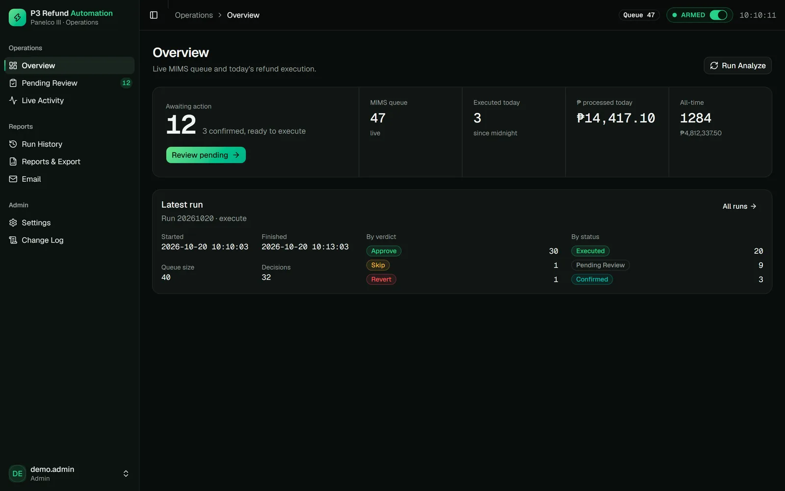
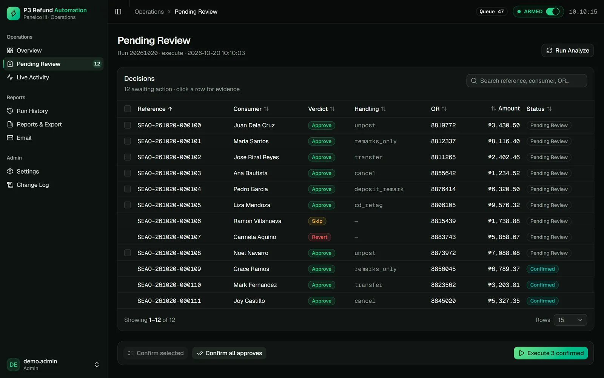
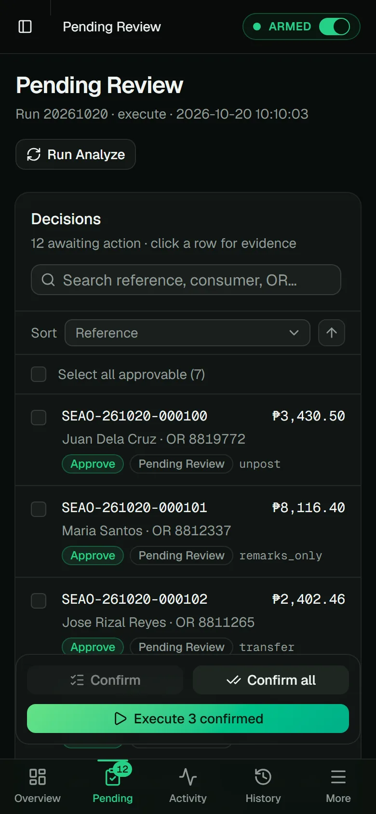
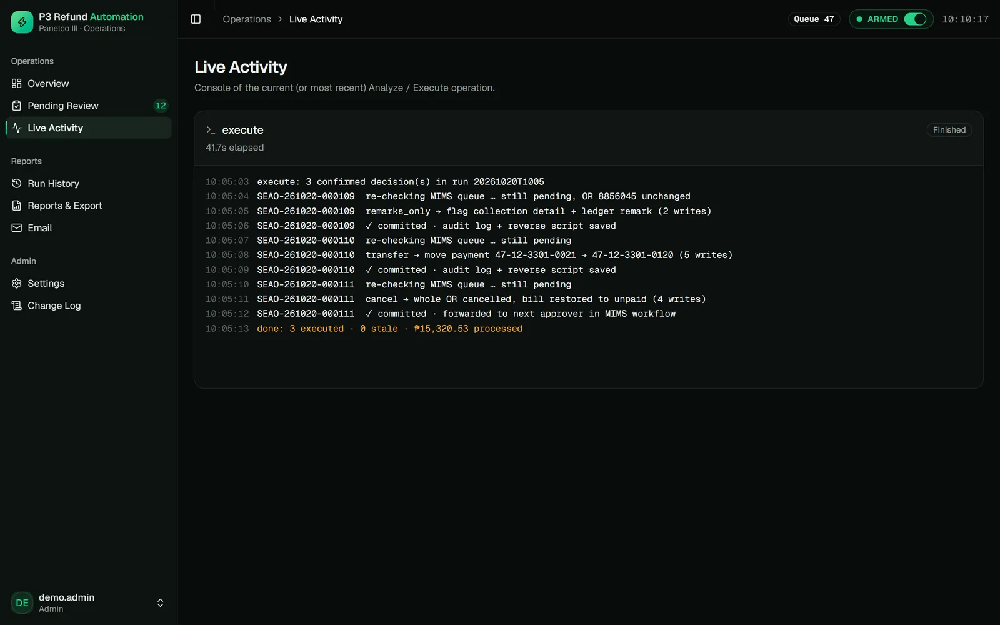
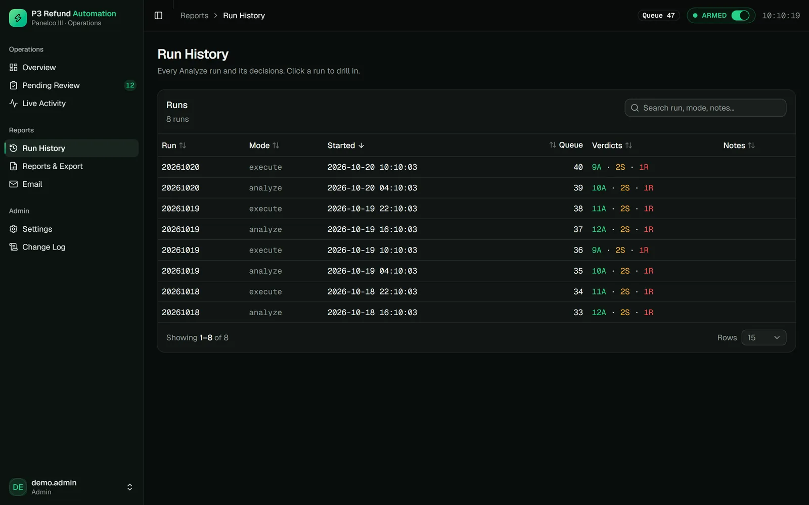
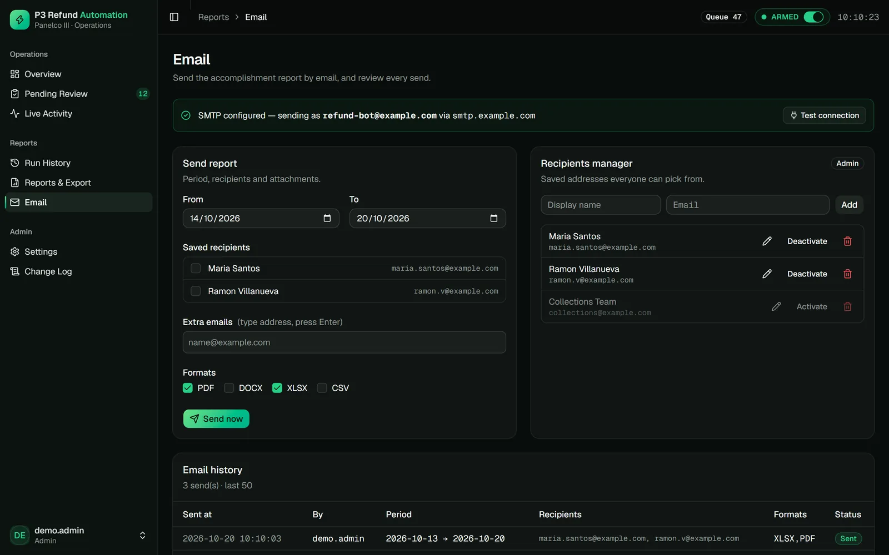

# AI-Assisted Refund Automation

> An LLM reads the messy cases and explains them in plain Taglish, while deterministic rules and a human keep sole authority over money.

**Status:** In production · **Client:** 250K-member electric cooperative · **Role:** Solo architect & engineer

**Stack:** `Claude (headless)` `Python` `FastAPI` `MS SQL Server` `Human-in-the-Loop`

> [!NOTE]
> **Showcase repository.** The source code is private and belongs to the client. This repo documents the problem, the architecture, and the results. Screens show demo data. Full case study: https://lesjohnpauloliver.dev/work/ai-assisted-refund-automation

## Summary

Automates a utility's daily refund and payment-correction approval queue across two legacy systems. Deterministic recipes decide, Claude explains the flagged cases, and a human confirms every action.

## Scale

- The queue had a 76-item backlog when the project started
- 538 pytest tests across the pipeline, recipes, API, auth, and reports
- 7 request types, each its own recipe module
- Spans two legacy systems with no API: a workflow app and the billing and collections system

## The problem

- Every refund or correction meant reading a request, cross-checking the receipt against the ledger in one system, changing the ledger by hand, then approving in another.
- Each manual step was a chance to post money to the wrong account.
- Unusual cases sat in the queue with no explanation of what was wrong.

## Problem → fix

### Every refund or correction meant reading the request, checking the receipt against the ledger in one system, fixing the ledger by hand, then approving in another.

A daily analyze run pulls the live queue, matches each request to its ledger rows, and returns approve, skip, or revert with a reason. Approval needs the receipt number, date, and amount to all match.

Overview: what is awaiting action, the live queue, and the latest analyze/execute run.

### Each manual step was a chance to post money to the wrong account.

Nothing touches the ledger until a person confirms. Each execute re-checks live state, skips anything stale, writes in one transaction, and saves a reverse script.

Pending review: every refund request with its verdict and planned handling, confirmed by a person before anything runs.

The review queue on a phone, with confirm and execute actions.

Live activity console: each executed item re-checked, committed with an audit log, and a reverse script saved.

### Unusual cases sat in the queue with no explanation of what was wrong.

Claude reads each flagged case with read-only tools and returns a short Taglish explanation, a suggested field fix, and a confidence. It never writes or approves; the rules re-decide with the fix and a person confirms.

### A change to someone's money has to be traceable and reversible after the fact.

Every run is logged with its verdict mix, every executed change has an audit record and a reverse script, and accomplishment reports go out by email as PDF, Word, Excel, or CSV.

Run history: every analyze and execute run with its verdict mix, for a complete audit trail.

Email reports: accomplishment reports sent to saved recipients in PDF, Word, Excel, or CSV.

## Approach

- Staged autonomy: analyze, decide, human confirm, then execute. Nothing touches the ledger without the confirm gate.
- Approvals need positive evidence: receipt number, date, and amount must all match the ledger rows.
- The AI is advisory only. It runs with read-only tools, answers in a fixed JSON schema, and never writes or approves.
- AI notes are cached per case and capped per run, and an AI failure never fails the batch.

## What was built

- Daily analyze run that classifies each request and returns approve, skip, or revert with a reason
- Per-type recipes that execute in one transaction with a saved reverse script
- AI analyst notes on every flagged item, plus "Plan with AI" and "Execute with AI"
- Operator dashboard with the why, the planned writes, and the confirm button
- Accomplishment and audit reports emailed as PDF, Word, Excel, or CSV

## Capabilities

**Pipeline**
- Analyze: pulls the live approver queue and enriches each request with the ledger rows it refers to
- Decide: a recipe per request type returns approve (with an exact ledger plan), skip, or revert
- Confirm: a person reviews the evidence before anything runs
- Execute: re-checks live state, skips anything stale, writes in one transaction, and forwards the item to the next approver

**AI analyst**
- Headless Claude session per flagged item, read-only tools, fixed JSON schema
- Category, a 2 to 4 sentence Taglish explanation, a suggested field fix, the closest recipe, next action, and confidence
- Reads the requester's remarks and the full approval trail, and lists conflicts between remarks and records
- Recommends an execute path, or one yes/no question whose answer would automate the whole class of case

**Plan and Execute with AI**
- A suggested field fix becomes an in-memory override; the source record is never edited
- The same deterministic handler re-decides with the corrected input and shows the exact planned writes
- Executes only if the rules now approve, through the standard executor with a reverse script

**Request types**
- Standard refund and deposit refund
- Wrong-account correction and intended-month posting
- Receipt cancellation and collection-detail re-tag
- Details-list actions

**Safety and audit**
- Per-run item and peso caps
- Stale-state re-check before every write
- Full SQL audit trail and auto-generated reverse scripts
- Kill switch (an ARMED toggle)

**Dashboard and reports**
- Overview, pending review, live activity console, and run history
- Reports in PDF, Word, Excel, or CSV, emailed to saved recipients
- Responsive down to phone width

## Architecture

- Python pipeline: fetch, enrich, classify, decide, execute, with one module per request type.
- FastAPI serves the API and a React 19 dashboard built into one self-contained HTML file, so deployment is copying a folder.
- SQL Server for both legacy systems, plus a separate decision and audit database.
- Claude Code runs headless in the repository, so each session starts with the project memory and recipe docs in context.

## Engineering

- Reverse-engineered a legacy platform with no API or docs: decoded program exports, binary date encodings, and code tables, then traced real operator sessions to learn which rows each screen writes.
- Every write recipe is backed by one of those traces.
- 538 pytest tests across the pipeline, recipes, API, auth, and reports.
- scrypt password hashing, login throttling and lockout, CSRF tokens, role-gated admin pages, and a settings change log.
- AI notes are cached by a hash of the reason, remarks, and approval trail, so a case is only re-asked when something new is said about it.

## Where AI does the work

Claude reads each flagged case read-only, explains what went wrong in plain Taglish, and suggests the fix, while deterministic rules and a human make every decision.

## Outcome

- A manual daily approval queue becomes dry-run, AI-explained, human-confirmed actions.
- Every executed change has an audit record and a reverse script.

---

Built by **[Les John Paul Oliver](https://lesjohnpauloliver.dev)**, AI Engineer in the Philippines: agentic AI, RAG, LLM evals, MCP, and business automation. [Case studies](https://lesjohnpauloliver.dev/#projects) · [Hire me](https://lesjohnpauloliver.dev/ai-engineer-philippines)
